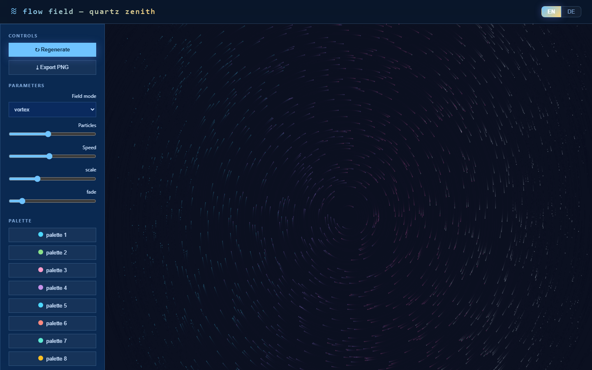
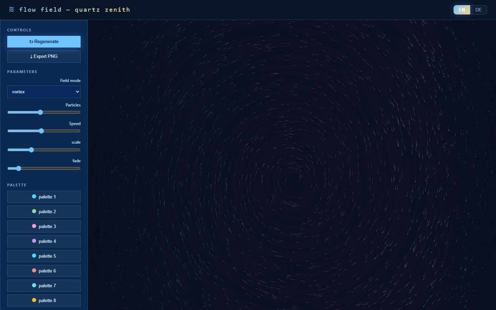
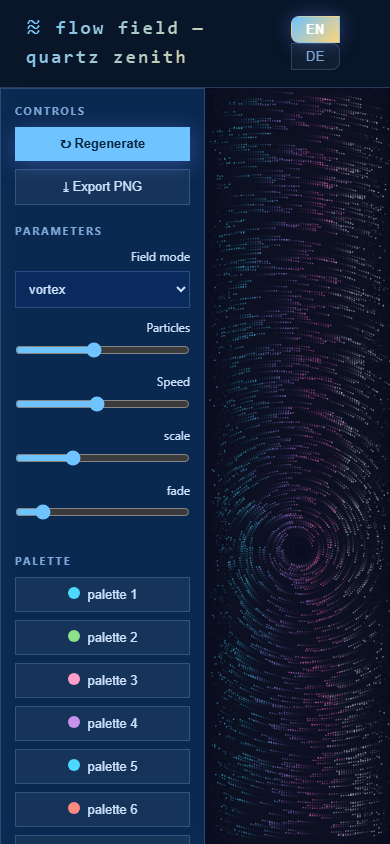

# Flow Field — Quartz Zenith

A living flow-field painter: 1880 particles trace vector fields in real time. vortex mode, seeded randomness and PNG export.

<div align="center">


**[Live Demo](https://ruslanfridenli.github.io/quartz-zenith/)** · **[Deutsch ↓](#-deutsch)**

</div>

---

## Screenshots







## Features

- Real-time particle flow-field rendering on canvas
- Multiple field modes: flow, vortex, spiral, noise
- Seeded generation — every artwork is reproducible
- Hand-tuned color palettes with trail fade
- One-click PNG export
- English/German interface

## Local development

```bash
git clone https://github.com/ruslanfridenli/quartz-zenith.git
cd quartz-zenith
# open index.html in a browser, or serve statically:
npx serve .
```

No build step, no dependencies — pure static site.

---

## 🇩🇪 Deutsch

### Quartz Zenith — Strömungsfeld

Ein lebendiger Strömungsfeld-Maler: 1880 Partikel zeichnen Vektorfelder in Echtzeit. vortex-Modus, reproduzierbarer Seed und PNG-Export.

### Funktionen

- Echtzeit-Partikel-Rendering von Strömungsfeldern
- Mehrere Feldmodi: Strömung, Wirbel, Spirale, Rauschen
- Gesperrte Generierung — jedes Bild ist reproduzierbar
- Handgestimmte Farbpaletten mit Nachleuchten
- PNG-Export per Klick
- Englische/deutsche Oberfläche

### Lokale Entwicklung

```bash
git clone https://github.com/ruslanfridenli/quartz-zenith.git
cd quartz-zenith
npx serve .
```

Reine statische Seite — kein Build-Schritt, keine Abhängigkeiten.

---

## ☕ Support / Unterstützen

Wenn dir diese Website beim Lernen hilft, würde mir eine Spende sehr viel bedeuten und dabei helfen, sie weiterzuentwickeln. Alternativ kannst du das Projekt mit einem Stern im github repo unterstützen. Vielen Dank!

- Solana: `zQpgZ6nGigww7vYpz3Qqxb1BT44kqS567vFaLTeHagS`
- Ethereum: `0x9c4fE1B2e9a1A9c22312c8296BB088Ca0e8F1B4e`
- Bitcoin: `bc1p2jltk9ya9kyzv35d8kxn7mmg9jqkx66cqtgzqwe75zlr4v9jk4hsv468q7`

---

Made with care. Feedback welcome via issues.
